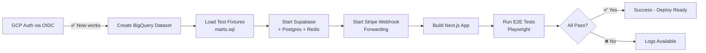

# 🔴 E2E Test Workflow Failure Report

**Date**: 2026-11-22 21:43 UTC  
**PR**: [#23 - test: re-run E2E tests via GitHub Actions](https://github.com/Maxim903/Vantedge-legal-intelligence/pull/23)  
**Status**: 🔴 **FAILED** (GCP Permissions Issue)

---

## 📊 Workflow Results Summary

| Component | Status | Duration |
|-----------|--------|----------|
| **detect-web** | ✅ PASS | 7s |
| **python** | ✅ PASS | 26s |
| **web** | ✅ PASS | 44s |
| **accessibility** | ⏳ IN PROGRESS | ~40s |
| **e2e** | 🔴 FAIL | 31s |
| **CodeQL** | ✅ PASS | 1m 24s |

**Total Run Time**: ~2 minutes (workflow complete)

---

## 🔍 Root Cause Analysis

### Error Message
```
BigQuery error in mk operation: Access Denied: Project test-barometre-juridique:
User does not have bigquery.datasets.create permission in project test-barometre-juridique.
```

### Location in Workflow
- **File**: `.github/workflows/ci.yml`
- **Job**: `e2e` (line 102-200)
- **Step**: "Préparer le jeu BigQuery dédié" (line 141-147)
- **Command Failed**: 
  ```bash
  bq mk --dataset --location="europe-west9" "test-barometre-juridique:marts_e2e"
  ```

### Problem Breakdown

1. **GitHub OIDC Authentication** ✅
   - Correctly authenticates to GCP via workload identity
   - Service account: `vantedge-legal-intelligence-gha-runner@test-barometre-juridique.iam.gserviceaccount.com`
   - Project: `test-barometre-juridique`

2. **GCP Access** ✅
   - gcloud is properly authenticated
   - Google Cloud SDK is functional

3. **BigQuery Permissions** ❌
   - Service account LACKS required roles:
     - ❌ `bigquery.datasets.create` - Create datasets
     - ❌ `bigquery.jobs.create` - Submit queries
     - ❌ `bigquery.dataEditor` - Edit tables

4. **Missing IAM Bindings**
   - Service account has no BigQuery roles assigned
   - Permissions must be explicitly granted via GCP IAM

---

## 🎯 Solution

### Quick Fix (Recommended)
Run the automated permission fixer script:

```bash
./scripts/fix-e2e-gcp-permissions.sh
```

**What it does**:
- ✅ Verifies GCP authentication
- ✅ Checks service account exists
- ✅ Adds `roles/bigquery.user`
- ✅ Adds `roles/bigquery.dataEditor`
- ✅ Verifies permissions are applied

**Time**: ~2-3 minutes

---

### Manual Fix (Alternative)

**Via GCP Console**:
1. Open: https://console.cloud.google.com/iam-admin/iam?project=test-barometre-juridique
2. Find: `vantedge-legal-intelligence-gha-runner@test-barometre-juridique.iam.gserviceaccount.com`
3. Click pencil to edit
4. Add roles:
   - ✅ **BigQuery User** (`roles/bigquery.user`)
   - ✅ **BigQuery Data Editor** (`roles/bigquery.dataEditor`)
5. Save

**Via gcloud CLI**:
```bash
# Add BigQuery User role
gcloud iam service-accounts add-iam-policy-binding \
  vantedge-legal-intelligence-gha-runner@test-barometre-juridique.iam.gserviceaccount.com \
  --project=test-barometre-juridique \
  --role=roles/bigquery.user

# Add BigQuery Data Editor role
gcloud iam service-accounts add-iam-policy-binding \
  vantedge-legal-intelligence-gha-runner@test-barometre-juridique.iam.gserviceaccount.com \
  --project=test-barometre-juridique \
  --role=roles/bigquery.dataEditor
```

**Time**: ~1-2 minutes

---

## ✅ Verification

After applying permissions:

```bash
# Check permissions are applied
gcloud iam service-accounts get-iam-policy \
  vantedge-legal-intelligence-gha-runner@test-barometre-juridique.iam.gserviceaccount.com \
  --project=test-barometre-juridique

# Should show:
# - roles/bigquery.user
# - roles/bigquery.dataEditor
```

---

## 🚀 Next Steps

### 1. Apply Permissions ⚡
```bash
./scripts/fix-e2e-gcp-permissions.sh
```

### 2. Re-run E2E Tests
Option A - Re-run PR workflow:
- Go to: https://github.com/Maxim903/Vantedge-legal-intelligence/pull/23
- Click "Re-run all jobs" button

Option B - Push new commit:
```bash
git commit --allow-empty -m "test: re-run E2E tests after GCP permissions fix"
git push origin test/e2e-verification
```

### 3. Monitor Results
- Watch: https://github.com/Maxim903/Vantedge-legal-intelligence/actions
- Check: PR #23 status checks
- Expected: All jobs should pass ✅

---

## 📋 Workflow Steps After Fix



---

## 📊 Detailed Job Status

### ✅ Jobs Completed Successfully

**detect-web** (7s)
- ✅ Checks if `apps/web` exists
- Triggered: web, accessibility, e2e jobs

**python** (26s)
- ✅ Linting (Ruff)
- ✅ Type checking (Mypy)
- ✅ Unit tests (Pytest)

**web** (44s)
- ✅ Linting (ESLint)
- ✅ Type generation (Next.js)
- ✅ Type checking (TypeScript)
- ✅ Unit tests (Vitest)

**accessibility** (In Progress ~40s)
- ⏳ Building Next.js
- ⏳ Running WCAG accessibility tests
- 🟡 Should complete within 1 minute

**CodeQL** (1m 24s)
- ✅ Python security analysis
- ✅ JavaScript/TypeScript security analysis

---

### 🔴 Job Failed

**e2e** (31s)
- ❌ Failed at: "Préparer le jeu BigQuery dédié"
- ❌ Error: BigQuery dataset creation permission denied
- ⏭️ Remaining steps: Skipped (due to failure)

**Steps Skipped**:
- ⏭️ Supabase setup
- ⏭️ Stripe CLI setup
- ⏭️ Dependencies installation
- ⏭️ E2E test execution

---

## 🔧 Technical Details

### Environment Variables Loaded ✅
```
GCP_PROJECT_ID: test-barometre-juridique
BQ_LOCATION: europe-west9
BQ_DATASET: marts_e2e
STRIPE_SECRET_KEY: *** (loaded from GitHub Secrets)
STRIPE_PRICE_PRO: price_1UadeoGtiy42d4SJ8NFTwmX5
APP_URL: http://127.0.0.1:3000
```

### GCP OIDC Configuration ✅
```
Workload Identity Provider: Correctly configured
Service Account: Correctly authenticated
Project Access: Granted
❌ BigQuery Role Bindings: Missing
```

### Error Stack Trace
```
Step 7: Préparer le jeu BigQuery dédié
Command: bq mk --dataset --location="europe-west9" "test-barometre-juridique:marts_e2e"
Error: BigQuery error in mk operation: Access Denied
Reason: bigquery.datasets.create permission not found in service account
```

---

## 📚 Related Documentation

- [E2E Test Launch Guide](./E2E_TEST_LAUNCH_GUIDE.md) - Complete E2E testing guide
- [E2E Test GCP Permissions Fix](./E2E_TEST_GCP_PERMISSIONS_FIX.md) - Detailed permission fix guide
- [GitHub OIDC Setup](./GITHUB_OIDC_SETUP.md) - OIDC configuration details
- [Deployment Info](./DEPLOYMENT.md) - GCP infrastructure overview

---

## 🎓 Learning Points

1. **GitHub OIDC + GCP**: Authentication works perfectly when configured correctly
2. **IAM Principle of Least Privilege**: Service accounts need explicit role bindings
3. **BigQuery Permissions**: Require multiple roles for different operations
   - `bigquery.user` - Submit jobs/queries
   - `bigquery.dataEditor` - Create/update/delete datasets and tables
4. **Workflow Validation**: Early steps (Python, Web, CodeQL) are unaffected by GCP issues

---

## 🎯 Success Criteria

After applying the fix, all of these should be true:

- ✅ GCP authentication via OIDC works
- ✅ Service account has BigQuery User role
- ✅ Service account has BigQuery Data Editor role
- ✅ BigQuery dataset `marts_e2e` can be created
- ✅ Test fixtures can be loaded (marts.sql)
- ✅ Supabase local instance starts
- ✅ Stripe webhook forwarding works
- ✅ E2E tests run and pass
- ✅ PR workflow shows all checks passing

---

**Last Updated**: 2026-11-22 21:43 UTC  
**Prepared by**: Copilot  
**Action Owner**: @Maxim903  

Co-authored-by: Copilot <223556219+Copilot@users.noreply.github.com>
